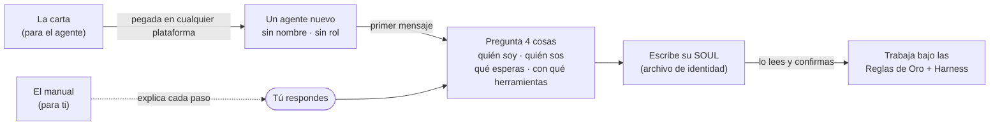

  

  
  
  
  

<a href="README.md">English</a> · <b>Español</b>

**Una carta que pegas en cualquier agente de IA para que, en su primer arranque, pregunte quién es, quién eres tú y qué esperas de él, en vez de adivinar.** Alrededor de la carta: las Reglas de Oro que adopta, el Harness con el que trabaja y un manual para los *humanos* que quieren entender qué está haciendo el agente.

## El problema

Si le pasas a una plataforma de agentes un manual largo de "cómo crear agentes", el agente lo lee y **se convierte en creador de agentes**. Es lo contrario de lo que casi todos necesitan. Lo que se necesita es un buen *punto de partida* para un agente que va a hacer un trabajo: que sepa que tiene un humano responsable, que todavía no tiene personalidad ni rol, que sigue un conjunto corto de reglas que no puede relajar, y que no empieza a actuar hasta que le dicen qué se espera de él.

## La idea

Dos públicos, separados a propósito:

| Para el **agente**: texto que se le entrega tal cual | Para el **humano**: documentación |
| --- | --- |
| [`carta/`](carta/): las cartas (agente solo, líder de equipo) | [`docs/es/`](docs/es/README.md): este manual |
| [`reglas/`](reglas/): las Reglas de Oro | Dónde pegar la carta en cada plataforma y qué limita cada una |
| [`harness/`](harness/): el método de trabajo, en dos tamaños | Cómo leer lo que hace el agente: primer arranque, su SOUL, las reglas, una tarea |

## Empieza aquí en 2 minutos

1. **Elige una carta.** Un agente para ti → [`CARTA-AGENTE-SOLO`](carta/es/CARTA-AGENTE-SOLO.md). Un agente que va a liderar un equipo → [`CARTA-LIDER-DE-EQUIPO`](carta/es/CARTA-LIDER-DE-EQUIPO.md). Cada carta es autocontenida: las reglas y el método van adentro.
2. **Cópiala y pégala** donde tu plataforma guarda las instrucciones de un agente: [Claude Projects](docs/es/platforms/claude-projects.md) · [ChatGPT](docs/es/platforms/chatgpt.md) · [Claude Code](docs/es/platforms/claude-code.md) · [Codex](docs/es/platforms/codex.md) · [pi](docs/es/platforms/pi.md) · [Gemini](docs/es/platforms/gemini.md) · [Amazon Quick](docs/es/platforms/amazon-quick.md) · [otras](docs/es/platforms/other-tools.md). ¿Tu plataforma no está? Pégala como primer mensaje de una conversación nueva.
3. **Saluda.** La primera respuesta del agente tiene que ser preguntas, no trabajo. Respóndelas. Después escribe su archivo de identidad, te lo muestra y recién empieza a trabajar cuando confirmas.
4. **Guarda el SOUL.** Conserva lo que escribió donde tu plataforma pueda volver a cargarlo. [Cada página de plataforma](docs/es/platforms/README.md) dice dónde.

Si el agente se pone a trabajar, inventa una personalidad o empieza a "crear agentes" en vez de preguntar, mira [Si algo sale mal](docs/es/troubleshooting.md).

## Qué hay adentro

| Ruta | Qué | Escrito para |
| --- | --- | --- |
| [`carta/`](carta/) | Cartas de arranque: agente solo y líder de equipo (ES/EN) | el agente |
| [`reglas/`](reglas/) | Las Reglas de Oro | el agente (y tú) |
| [`harness/`](harness/) | El Harness: tamaño agente solo y tamaño oficina | el agente (y tú) |
| [`docs/es/`](docs/es/README.md) · [`docs/en/`](docs/en/README.md) | Manual para humanos | ti |
| [`evidencia/`](evidencia/) | Transcripciones de pruebas de primer arranque con agentes limpios | quien revisa |

## Lee esto antes de confiar en él

- **Una carta son instrucciones, no un sandbox.** Moldea el comportamiento; no impide que un agente haga lo que sus herramientas y permisos le permiten. Mantén los permisos al mínimo y empieza en modo lectura. El [manual](docs/es/README.md) explica cómo, plataforma por plataforma.
- **Los modelos varían.** Cada modelo sigue una carta larga con distinta fidelidad, y los límites de las plataformas (largo de instrucciones, memoria, acceso a archivos) cambian seguido. Probamos con agentes limpios y guardamos las transcripciones en [`evidencia/`](evidencia/); vuelve a probar con tu modelo antes de confiar.
- **El SOUL es una propuesta.** El agente redacta su propio archivo de identidad; tú lo lees, lo corriges y lo confirmas. Ver [Cómo leer a tu agente](docs/es/reading-your-agent/README.md).

## De dónde sale esto

El método se desarrolló operando una flota real de agentes día a día: lo que funcionó se volvió regla y harness; lo que falló, los postmortems detrás de ellos. Nada de las identidades, datos ni despliegues de esa flota está en este repositorio; las cartas son neutras a propósito: cada agente construye su personalidad *con su humano*.

## Parte de la plataforma de agentes de Otixe

Otixe construye equipos de agentes persistentes y responsables: **Pi** (runtime) → **Oficinas** (equipos persistentes) ↔ **Cerebro** (memoria compartida y estado de trabajo) ↔ **Sinapsis** (superficie de control web), con **AMA** conectando el runtime con Cerebro. Este repositorio es la puerta de entrada para *cualquier* agente, corra en el runtime que corra.

[Perfil de Otixe](https://github.com/otixe) · [Manual de la plataforma](https://github.com/otixe/plataforma) · [pi-oficinas](https://github.com/otixe/pi-oficinas)

## Licencia

MIT — ver [LICENSE](LICENSE).
