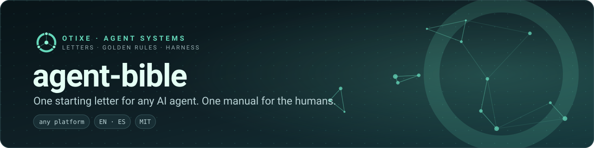
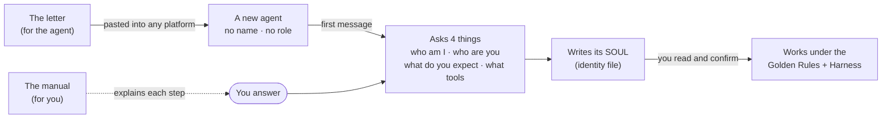

  

  
  
  
  

<b>English</b> · <a href="README.es.md">Español</a>

**A letter you paste into any AI agent so that, on its first run, it asks who it is, who you are and what you expect — instead of guessing.** Around the letter: the Golden Rules it adopts, the Harness it works by, and a manual for the *humans* who want to understand what the agent is doing.

## The problem

If you hand an agent platform a long "how to create agents" manual, the agent reads it and **becomes the agent-creator**. That is the opposite of what most people need. They need a good *starting point* for an agent that will do a job: one that knows it has a human responsible for it, that has no personality or role yet, that follows a short set of rules it cannot relax, and that will not start acting until it has been told what is expected.

## The idea

Two audiences, kept apart on purpose:

| For the **agent** — text it is given as-is | For the **human** — documentation |
| --- | --- |
| [`carta/`](carta/): the letters (single agent, team lead) | [`docs/en/`](docs/en/README.md): this manual |
| [`reglas/`](reglas/): the Golden Rules | Where to paste the letter on each platform and what each one limits |
| [`harness/`](harness/): the working method, in two sizes | How to read what the agent does: first run, its SOUL, the rules, a task |

## Start in 2 minutes

1. **Pick a letter.** One agent for you → [`LETTER-SOLO-AGENT`](carta/en/LETTER-SOLO-AGENT.md). An agent that will lead a team → [`LETTER-TEAM-LEAD`](carta/en/LETTER-TEAM-LEAD.md). Each letter is self-contained: rules and method are inside.
2. **Copy it and paste it** where your platform keeps an agent's instructions: [Claude Projects](docs/en/platforms/claude-projects.md) · [ChatGPT](docs/en/platforms/chatgpt.md) · [Claude Code](docs/en/platforms/claude-code.md) · [Codex](docs/en/platforms/codex.md) · [pi](docs/en/platforms/pi.md) · [Gemini](docs/en/platforms/gemini.md) · [Amazon Quick](docs/en/platforms/amazon-quick.md) · [anything else](docs/en/platforms/other-tools.md). No platform listed? Paste it as the first message of a new conversation.
3. **Say hello.** The agent's first reply should be questions, not work. Answer them. It then writes its identity file, shows it to you, and only starts working once you confirm.
4. **Keep the SOUL.** Save what it wrote where your platform can reload it. [Each platform page](docs/en/platforms/README.md) says where.

If the agent starts working, invents a personality, or begins "creating agents" instead of asking, see [Troubleshooting](docs/en/troubleshooting.md).

## What is inside

| Path | What | Written for |
| --- | --- | --- |
| [`carta/`](carta/) | Starting letters: single agent and team lead (EN/ES) | the agent |
| [`reglas/`](reglas/) | The Golden Rules | the agent (and you) |
| [`harness/`](harness/) | The Harness: single-agent size and office size | the agent (and you) |
| [`docs/en/`](docs/en/README.md) · [`docs/es/`](docs/es/README.md) | Manual for humans | you |
| [`evidencia/`](evidencia/) | Transcripts of clean-agent first-run tests | reviewers |

## Read this before relying on it

- **A letter is instructions, not a sandbox.** It shapes behaviour; it does not stop an agent from doing what its tools and permissions allow. Keep permissions minimal and start read-only. The [manual](docs/en/README.md) says how, platform by platform.
- **Models vary.** Different models follow a long letter with different fidelity, and platform limits (instruction length, memory, file access) change often. We test with clean agents and keep the transcripts in [`evidencia/`](evidencia/); re-test with your own model before trusting it.
- **The SOUL is a proposal.** The agent drafts its own identity file; you read it, correct it and confirm it. See [Reading your agent](docs/en/reading-your-agent/README.md).

## Where this comes from

The method was developed running a real fleet of agents day to day: what worked became the rules and the harness, what failed became the postmortems behind them. None of that fleet's identities, data or deployments are in this repository; the letters are neutral on purpose — each agent builds its own personality *with its human*.

## Part of the Otixe agent platform

Otixe builds persistent, accountable agent teams: **Pi** (runtime) → **Oficinas** (persistent teams) ↔ **Cerebro** (shared memory and work state) ↔ **Sinapsis** (web control surface), with **AMA** connecting the runtime to Cerebro. This repository is the entry point for *any* agent, whatever runtime it runs on.

[Otixe profile](https://github.com/otixe) · [Platform manual](https://github.com/otixe/plataforma) · [pi-oficinas](https://github.com/otixe/pi-oficinas)

## License

MIT — see [LICENSE](LICENSE).
