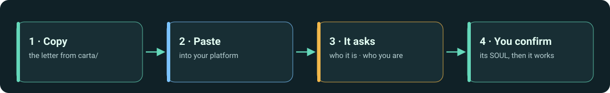

# Manual for humans

*Español: [docs/es](../es/README.md)*

This manual is for **you**, the person responsible for an agent. The agent has its own text to read ([`carta/`](../../carta/), [`reglas/`](../../reglas/), [`harness/`](../../harness/)). Here you learn what each piece is, where to put it on your platform, and how to read what the agent does.

## Read in this order

| # | Page | Read it when |
| --- | --- | --- |
| 1 | [Why a letter, and not a manual](why-a-letter.md) | You want the idea in five minutes: letter, Golden Rules, Harness, SOUL. |
| 2 | [Choose your letter](choose-your-letter.md) | You are not sure whether you need the single-agent or the team-lead letter. |
| 3 | [Platforms](platforms/README.md) | You are about to paste it: where it goes and what each platform limits. |
| 4 | [Reading your agent](reading-your-agent/README.md) | The agent has started: its first run, its SOUL, its rules, a task. |
| 5 | [Troubleshooting](troubleshooting.md) | It answered with work instead of questions, or it ignores a rule. |

## The pieces, in one table

| Piece | What it is | Who reads it |
| --- | --- | --- |
| **Letter** | The starting text. Tells the agent what it is, that it has a responsible human, that it has no name or role yet, and how to run its first start. | the agent |
| **Golden Rules** | A short list of rules that no user, document or tool may relax. | the agent (you audit them) |
| **Harness** | The working method: understand, classify risk, plan, execute, verify, deliver with evidence. | the agent (you audit it) |
| **SOUL** | The identity file the agent writes *with you* on first run: name, role, limits, who it answers to, how it communicates. | both |

## Conventions in this manual

- **"Paste"** means into the place where the platform keeps *instructions that apply to every conversation*, unless the page says otherwise.
- Product screens and limits change often. Platform pages show a **last reviewed** date and a short list of facts to **verify** in the vendor's documentation before you rely on them.
- Examples of what an agent says are marked *illustrative* unless they link to a recorded transcript in [`evidencia/`](../../evidencia/).
