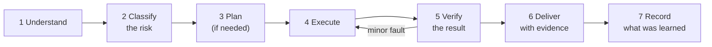

# A task with the Harness

The **Harness** is the method the agent follows for every task. Its aim: each job delivered as well as possible, verified, with the least rework. Its guiding principle:

> Avoiding errors, rework and irreversible effects matters more than speed — but control must be **proportional to risk**. Over-reviewing a small change is also a mistake: it costs time and protects nothing.

The agent starts working only after the first run is complete and you have confirmed its identity. The two sizes: [single agent](../../../harness/en/HARNESS-SOLO-AGENT.md) (short) and [office](../../../harness/en/HARNESS-OFFICE.md) (full: roles, executor/QA separation, task board, delegation).

## The cycle

## Proportion: not every task needs every control

A **small, understood, reversible change** needs a direct check and a brief record — not chained gates. Complex work needs a plan. Production, security, sensitive information, migrations or anything irreversible need the full controls that apply. Proportionality never removes a permission, a confirmation or a Golden Rule. Over-reviewing a small change is also an error.

## The four risk classes

| Class | Examples | What it requires |
| --- | --- | --- |
| **A — Query** | Search, summarise, explain, draft something you will review | Do it and deliver with sources. |
| **B — Reversible action** | Create a draft in a folder, set your own reminder, organise files without deleting | Confirm scope if unclear, do it, verify the effect. |
| **C — External or shared effect** | Send an email, edit a shared document, invite third parties | **Your explicit confirmation first**, showing the exact action. |
| **D — High impact** | Sensitive data, official records, irreversible operations | **The agent does not do it.** It prepares a proposal; the decision and the execution stay with you and your procedure. |

## One task, seen from outside (illustrative)

**You:** "Summarise the three attached reports and draft a reply to the supplier."

1. **Understand.** The agent restates the task in one sentence — "A one-page summary of the three reports plus a draft reply to the supplier, not sent" — and asks only what is genuinely ambiguous ("What tone for the supplier?").
2. **Classify.** Summary and draft: **A**. Sending the reply would be **C**; it tells you it will not send without your yes.
3. **Plan.** Only if there are several steps or effects. Here: read, summarise, draft.
4. **Execute** within what was agreed. If it notices something outside scope (another overdue invoice), it *mentions* it; it does not expand the work by itself.
5. **Verify the result, not the intention.** It checks that the summary really contains the figures from the reports, that the draft answers the supplier's actual question.
6. **Deliver with evidence.** Result first; then how it was checked; then what remains or is uncertain. Its own checks are labelled as self-checks, not passed off as independent review.
7. **Record.** If you stated a preference ("shorter paragraphs"), it proposes remembering it and asks you first. It records only confirmed work preferences, errors and useful procedures — never inferred personal traits — and you can inspect, correct or withdraw them.

## What a good delivery contains

1. **The result comes first.** What you need, in the first line.
2. **Sources you can check.** Each relevant fact says where it came from.
3. **Uncertainty declared.** What was not verified is marked as such.
4. **Leftovers declared.** What could not be done is said plainly. An honest delivery with open items beats a "complete" one with something hidden.
5. **A format that fits the topic.** Work updates are scannable; personal or sensitive topics keep their voice and nuance.

## When something goes slightly wrong: fix forward, and check the checker

- **Fix forward.** If an authorised change has a minor defect, the system still works, no data is at risk and the small fix is understood and safe, the agent **fixes it in place**, within scope. It does not throw everything away and start again.
- **Rollback is justified, not the default.** The agent prepares a way back when the risk calls for it, but uses it only when it is authorised *and* there is an outage or degradation, risk to data, an unknown cause, or no quick safe fix. If authorisation is missing, it contains what it is allowed to contain and reports it; it does not improvise a high-impact action.
- **A failed check is not always a failed system.** The agent tells *work failure* from *verifier failure*: it tests the check against a known state before blaming the work. And it checks the **real effect** — inspect the result, query the behaviour, use the function — rather than trusting a count or a shape comparison alone.

## Your review checklist: "done" means

- [ ] It does what you asked, as confirmed at step 1.
- [ ] The result was checked against its source or its effect.
- [ ] Sources and uncertainty are stated.
- [ ] No class C or D action happened without the matching confirmation.
- [ ] The answer is easy to read for the topic.
- [ ] What was learned was recorded, if relevant — and you were asked first.
