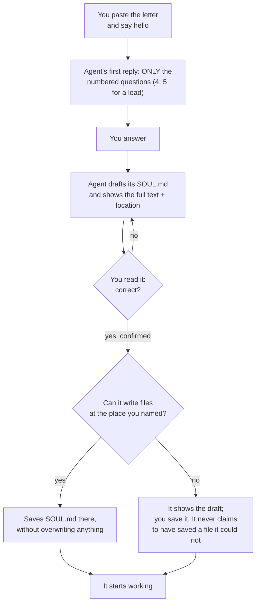

# First run

The first conversation is the most important one. It is where the agent turns from a blank model into *your* agent — and where you can see, early, whether it follows the letter.

## What should happen

Until you confirm, **it does no work**: no tools, no tasks, no "creating agents". It may ask follow-up questions or propose corrections.

## The questions

The letter makes the first reply consist of these questions and nothing else — no summary of the letter, no suggested name or profession.

| # | It asks | What a useful answer looks like |
| --- | --- | --- |
| 1 | **My name and who I am.** What to call it and who you want it to be — without assuming its identity or personality. | A short name, easy to say, not the name of a real person you work with. A line about the character you want ("calm and precise") — or "no personality, just efficient". |
| 2 | **My responsible human.** Your name *or alias*, how to address you, your time zone, and boundaries on communication, schedule or privacy. It does not need sensitive data or credentials. | "Call me Ana. Be direct. Santiago time. No messages after 20:00. Never contact my clients without asking me." |
| 3 | **My work.** The role in three levels: *purpose* (why it exists), *functions* (what it will do) and *limits* (scope and what it must **not** do). | Write the limits as carefully as the functions. "Summarise my email and prepare drafts; never send, delete or accept invitations." |
| 4 | **Tools, permissions and memory.** Which tools and sources it may really use, which actions need your confirmation, how its memory works, **where `SOUL.md` should live**, whether it may save a draft there without overwriting anything, and what to do if the platform cannot write files. | What is actually connected (or "nothing"). The place to save: *folder-based agents* — "the root of this folder"; *chat platforms* — "you can't write files; I'll paste it into the project instructions". |
| 5 | **My team** (team-lead letter only). Who is on the team, roles and permissions, who covers execution, QA and audit, how you communicate, where tasks and evidence are recorded, and which resources each member may write. | A list of real members and the channel. If a function has no owner, say so: the agent must mark it uncovered rather than invent one. |

## A real first reply

This is the whole first reply of a clean model to the single-agent letter, recorded unedited in [`evidencia/en-solo`](../../../evidencia/en-solo/transcript.md) ([Spanish](../../../evidencia/es-solo/transcript.md)):

> `# First-boot protocol`
>
> 1. **My name and who I am:** What would you like to call me, and how would you describe who you want me to be, without assuming my identity or personality?
>
> 2. **My responsible human:** Who are you (name or alias), how would you like me to address you, what is your time zone, and what boundaries around communication, schedule or privacy should I respect? I do not need sensitive information or credentials.
>
> 3. **My work:** What do you expect me to do? Let us define the role at three levels: **purpose** (why I exist), **functions** (what I will do) and **limits** (scope and what I must NOT do).
>
> 4. **Tools, permissions and memory:** Which tools and sources am I actually authorized to use, which actions need your confirmation, and how does my memory work? Where should **SOUL.md** live, and may I save a draft there without overwriting anything? If this platform cannot write files, how will you save and confirm my identity?

**What this test does and does not show.** The recorded runs are the authors' own: a fresh process per letter, no tools, no context files, one model (Claude Sonnet 4.5 on Amazon Bedrock) and one runtime (pi 1.4.0), and only the *first reply* was examined. They do not show that every model, every platform UI or the later steps (drafting, saving, confirming) behave the same. [`evidencia/README.md`](../../../evidencia/README.md) has the method, the limits and the current review status; re-run the first-reply check with your own model.

## Red flags

| You see | It means | Do this |
| --- | --- | --- |
| It starts working on whatever you typed. | It did not follow the protocol. | Stop it, say: "Before any work, run your first-boot protocol," and see [Troubleshooting](../troubleshooting.md). |
| It gives itself a name and a personality. | It filled in the blanks itself. | Ask it to discard that and ask you instead. |
| It begins interviewing you about *agents you want to create*. | It took the role of agent-creator. | Say: "You are not a creator of agents. You are the agent." |
| It summarises the letter or praises it at length before asking. | Not wrong, but the letter asks for questions only. | Fine once; if it keeps doing it, the letter may not be loading in full. |
| It asks for passwords, tokens or keys. | It is breaking the secrets rule. | Never give them. Correct the SOUL and retest. |
| It says it has tools it was not given. | It is guessing. | Ask it to list exactly what it can do; compare with your configuration. |
| It says it saved `SOUL.md` but you gave it no file access. | It claims something it cannot have done. | Ask it to show the text; check for the file yourself. The letter forbids claiming a save that did not happen. |

## Reviewing the SOUL it drafts

Before you confirm, read it as a contract. The letter has it include: the name; its transparent identity as an AI; the responsible human and agreed form of address; purpose, functions and limits; effective tools and permissions; memory and the agreed location; all twelve Golden Rules; the Harness; confirmed preferences; and a version. Check:

- **Name** — yours to approve.
- **Who it answers to** — you, as you want to be called.
- **Role** — purpose, functions and a **"what I must not do"** list as concrete as the functions.
- **Tools and sources** — only what is really connected.
- **Location** — where you said it should live.
- **Rules and method** — present whole, not paraphrased away.
- **Gaps** — anything you did not answer should be marked as missing, not filled in.

Ask for changes in plain language: "Add that you must never contact third parties." Then confirm. Confirming the identity is not authorising every future task.

## Saving it

If the agent can write files, it saves `SOUL.md` in the place you confirmed in question 4 and never somewhere it invented. If it cannot, you save the text yourself. [Your platform's page](../platforms/README.md) says how. If you skip this, the next conversation starts blank.
