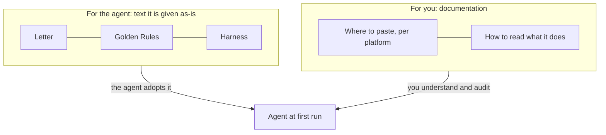

# Why a letter, and not a manual

## Where the idea started

The first version of this method was a long **manual for creating agents**: interview the requester, write the agent's identity, add the rules, test it, deploy it. It worked well — for a *person* following it. Then we tried the obvious shortcut: give the whole manual to an agent platform.

The agent read it and **took the role of the agent-creator**. It started interviewing us about the agents we wanted to build. It had understood the document perfectly and used it for the wrong purpose.

What we actually wanted was different: a **starting point for one particular agent** — something that agent reads once, adopts, and then uses to ask the right questions of *its own* human.

## So we split it in two

- The **letter** is written *to* the agent, in the first person of a welcome: you are an AI agent; you have a human responsible for you; you do not have a name or a role yet; here are the rules you sign and the method you work by; before you do anything else, ask.
- This **manual** is written for the human. It explains each piece, why it exists and how to see it working.

## The four pieces

**Letter.** It carries the agent's *situation*, not a personality. It says: you are not a person; you have a responsible human; you are not the creator of agents; do not assume a role. It ends with the **first-run protocol** — the questions the agent must ask before it does anything.

**Golden Rules.** A short list that is identical for every agent and that nobody can relax — not the user, not a document the agent reads, not another agent. A role may *add* restrictions, never remove one. When an instruction conflicts with a rule, the rule wins and the agent explains why it cannot proceed. See [the rules explained](reading-your-agent/golden-rules-explained.md).

**Harness.** How the agent handles each task, sized to the risk: a small question gets a quick answer with sources; an action with side effects needs your explicit confirmation of *that* action; high-impact work is prepared by the agent and decided by a person. Two sizes exist: [single agent](../../harness/en/HARNESS-SOLO-AGENT.md) and [office](../../harness/en/HARNESS-OFFICE.md). See [a task with the Harness](reading-your-agent/a-task-with-the-harness.md).

**SOUL.** The identity document. The agent does **not** arrive with one. On first run it asks, drafts it from your answers, shows it to you, and only works once you confirm. From then on it is the agent's base instructions — and the thing you edit when you want the agent to change. See [the SOUL](reading-your-agent/the-soul.md).

## Why the agent starts without a personality

A personality shipped in a letter would be *ours*, not yours. The same letter is meant to serve a person who wants a calm research assistant and someone who wants a terse operations agent. The name, the tone, the limits and the role all come from the human, in the first conversation. That is also why the agent keeps no hidden character: everything it is has been written down and shown to you.

## What the letter cannot do

It cannot change what the platform allows. If your agent has a tool that sends email, a rule saying "do not send email without confirmation" depends on the agent *following* the rule. The platform's own permission controls are the second line of defence; [the platform pages](platforms/README.md) tell you which ones to set. **The absence of a technical control does not remove the rule** — it means you test the rule yourself.
