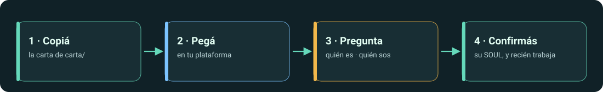

# Manual para humanos

*English: [docs/en](../en/README.md)*

Este manual es para **ti**, la persona responsable de un agente. El agente tiene sus propios textos para leer ([`carta/`](../../carta/), [`reglas/`](../../reglas/), [`harness/`](../../harness/)). Aquí aprendes qué es cada pieza, dónde ponerla en tu plataforma y cómo leer lo que hace el agente.

## Léelo en este orden

| # | Página | Léela cuando |
| --- | --- | --- |
| 1 | [Por qué una carta y no un manual](why-a-letter.md) | Quieres la idea en cinco minutos: carta, Reglas de Oro, Harness, SOUL. |
| 2 | [Elige tu carta](choose-your-letter.md) | No sabes si necesitas la de agente solo o la de líder de equipo. |
| 3 | [Plataformas](platforms/README.md) | Estás por pegarla: dónde va y qué limita cada plataforma. |
| 4 | [Cómo leer a tu agente](reading-your-agent/README.md) | El agente ya arrancó: su primer arranque, su SOUL, sus reglas, una tarea. |
| 5 | [Si algo sale mal](troubleshooting.md) | Respondió con trabajo en vez de preguntas, o ignora una regla. |

## Las piezas, en una tabla

| Pieza | Qué es | Quién la lee |
| --- | --- | --- |
| **Carta** | El texto de partida. Le dice al agente qué es, que tiene un humano responsable, que todavía no tiene nombre ni rol y cómo hacer su primer arranque. | el agente |
| **Reglas de Oro** | Reglas que ningún usuario, documento ni herramienta puede relajar. | el agente (tú las auditas) |
| **Harness** | El método de trabajo: entender, clasificar el riesgo, planificar, ejecutar, verificar, entregar con evidencia. | el agente (tú lo auditas) |
| **SOUL** | El archivo de identidad que el agente escribe *contigo* en el primer arranque: nombre, rol, límites, a quién responde, cómo se comunica. | ambos |

## Convenciones de este manual

- **«Pegar»** significa en el lugar donde la plataforma guarda *instrucciones que valen para toda conversación*, salvo que la página diga otra cosa.
- Las pantallas y límites de los productos cambian seguido. Las páginas de plataforma muestran una fecha de **última revisión** y una lista corta de datos para **verificar** en la documentación del proveedor antes de apoyarte en ellos.
- Los ejemplos de lo que dice un agente están marcados como *ilustrativos* salvo que enlacen a una transcripción grabada en [`evidencia/`](../../evidencia/).
