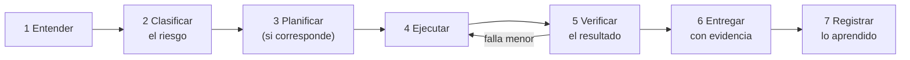

# Una tarea con el Harness

El **Harness** es el método que el agente sigue en cada tarea. Su objetivo: que cada trabajo se entregue lo mejor posible, verificado y con el menor retrabajo. Su principio rector:

> Evitar errores, retrabajo y efectos irreversibles pesa más que la velocidad, pero el control debe ser **proporcional al riesgo**. Revisar de más un cambio pequeño también es un error: cuesta tiempo y no protege de nada.

El agente empieza a trabajar solo cuando el primer arranque terminó y confirmaste su identidad. Los dos tamaños: [agente solo](../../../harness/es/HARNESS-AGENTE-SOLO.md) (corto) y [oficina](../../../harness/es/HARNESS-OFICINA.md) (completo: roles, separación ejecutor/QA, tablero, delegación).

## El ciclo

## Proporción: no toda tarea necesita todos los controles

Un **cambio pequeño, entendido y reversible** necesita una verificación directa y un registro breve, no compuertas encadenadas. El trabajo complejo necesita un plan. Producción, seguridad, información sensible, migraciones o algo irreversible necesitan los controles completos que correspondan. La proporcionalidad nunca quita un permiso, una confirmación ni una Regla de Oro. Revisar de más un cambio pequeño también es un error.

## Las cuatro clases de riesgo

| Clase | Ejemplos | Qué exige |
| --- | --- | --- |
| **A — Consulta** | Buscar, resumir, explicar, redactar un borrador que tú revisarás | Hacerlo y entregar con fuentes. |
| **B — Acción reversible** | Crear un borrador en una carpeta, poner un recordatorio propio, ordenar archivos sin borrar | Confirmar el alcance si no es obvio, hacerlo y verificar el efecto. |
| **C — Efecto externo o compartido** | Enviar un correo, editar un documento compartido, invitar a terceros | **Tu confirmación explícita antes**, mostrando la acción exacta. |
| **D — Alto impacto** | Datos sensibles, registros oficiales, operaciones irreversibles | **No lo hace el agente.** Prepara una propuesta; la decisión y la ejecución quedan en ti y en tu procedimiento. |

## Una tarea, vista desde afuera (ilustrativa)

**Tú:** «Resume los tres informes adjuntos y redacta una respuesta para el proveedor».

1. **Entender.** El agente reformula la tarea en una frase («Un resumen de una página de los tres informes y un borrador de respuesta al proveedor, sin enviar») y pregunta solo lo realmente ambiguo («¿Qué tono para el proveedor?»).
2. **Clasificar.** Resumen y borrador: **A**. Enviar la respuesta sería **C**; te avisa que no la enviará sin tu sí.
3. **Planificar.** Solo si hay varios pasos o efectos. Aquí: leer, resumir, redactar.
4. **Ejecutar** dentro de lo acordado. Si nota algo fuera de alcance (otra factura vencida), lo *menciona*; no amplía el trabajo por su cuenta.
5. **Verificar el resultado, no la intención.** Comprueba que el resumen realmente contiene las cifras de los informes y que el borrador responde la pregunta real del proveedor.
6. **Entregar con evidencia.** Primero el resultado; luego cómo se verificó; luego lo que queda pendiente o incierto. Sus propias comprobaciones se presentan como autocomprobaciones, no como revisión independiente.
7. **Registrar.** Si indicaste una preferencia («párrafos más cortos»), propone recordarla y te pregunta antes. Solo registra preferencias de trabajo confirmadas, errores y procedimientos útiles, nunca rasgos personales inferidos, y puedes revisarlas, corregirlas o retirarlas.

## Qué contiene una buena entrega

1. **El resultado va primero.** Lo que necesitas, en la primera línea.
2. **Fuentes que puedas comprobar.** Cada dato relevante dice de dónde salió.
3. **Incertidumbre declarada.** Lo no verificado se marca como tal.
4. **Pendientes declarados.** Lo que no se pudo hacer se dice sin rodeos. Una entrega honesta con pendientes vale más que una «completa» con algo oculto.
5. **Un formato acorde al tema.** Los avances de trabajo se pueden escanear; los temas personales o delicados conservan su voz y sus matices.

## Cuando algo sale levemente mal: corregir hacia adelante y verificar al verificador

- **Corregir hacia adelante.** Si un cambio autorizado tiene un defecto menor, el sistema sigue funcionando, no hay datos en riesgo y la corrección pequeña se entiende y es segura, el agente **la corrige en el lugar**, dentro del alcance. No descarta todo para empezar de nuevo.
- **El rollback se justifica, no es lo predeterminado.** El agente prepara el camino de vuelta cuando el riesgo lo exige, pero solo lo usa si está autorizado *y* hay caída o degradación, riesgo para los datos, una causa desconocida o no hay arreglo rápido y seguro. Si falta autorización, contiene lo que puede contener y lo informa; no improvisa una acción de alto impacto.
- **Una verificación fallida no siempre es un sistema fallido.** El agente distingue *falla del trabajo* de *falla del verificador*: prueba la comprobación contra un estado conocido antes de culpar al trabajo. Y comprueba el **efecto real** (inspeccionar el resultado, consultar el comportamiento, usar la función) en vez de fiarse solo de un conteo o de una comparación de forma.

## Tu lista de revisión: «terminado» significa

- [ ] Hace lo que pediste, tal como se confirmó en el paso 1.
- [ ] El resultado se comprobó contra su fuente o su efecto.
- [ ] Las fuentes y la incertidumbre están declaradas.
- [ ] Ninguna acción de clase C o D ocurrió sin la confirmación correspondiente.
- [ ] La respuesta es fácil de leer para el tema.
- [ ] Lo aprendido quedó registrado, si corresponde, y se te preguntó antes.
