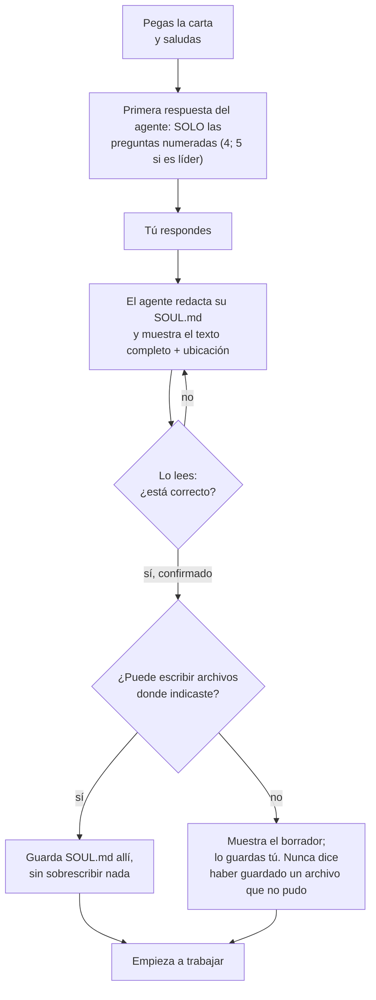

# Primer arranque

La primera conversación es la más importante. Ahí el agente pasa de ser un modelo en blanco a ser *tu* agente, y ahí puedes ver, temprano, si sigue la carta.

## Qué debería pasar

Hasta que confirmes, **no hace trabajo**: ni herramientas, ni tareas, ni «crear agentes». Puede hacer preguntas de seguimiento o proponer correcciones.

## Las preguntas

La carta hace que la primera respuesta sean estas preguntas y nada más: sin resumen de la carta, sin proponer nombre ni profesión.

| # | Pregunta | Cómo se ve una respuesta útil |
| --- | --- | --- |
| 1 | **Mi nombre y quién soy.** Cómo llamarlo y quién quieres que sea, sin darle por supuesta una identidad o personalidad. | Un nombre corto y fácil de decir, que no sea el de una persona real con quien trabajas. Una línea sobre el carácter que quieres («tranquilo y preciso»), o «sin personalidad, solo eficiente». |
| 2 | **Mi humano responsable.** Tu nombre *o alias*, cómo dirigirse a ti, tu zona horaria y límites de trato, horarios o privacidad. No necesita datos sensibles ni credenciales. | «Dime Ana. Sé directo. Hora de Santiago. Sin mensajes después de las 20:00. Nunca contactes a mis clientes sin preguntarme». |
| 3 | **Mi trabajo.** El rol en tres niveles: *propósito* (para qué existe), *funciones* (qué hará) y *límites* (alcance y lo que **no** debe hacer). | Escribe los límites con el mismo cuidado que las funciones. «Resume mi correo y prepara borradores; nunca envíes, borres ni aceptes invitaciones». |
| 4 | **Herramientas, permisos y memoria.** Qué herramientas y fuentes puede usar realmente, qué acciones requieren tu confirmación, cómo funciona su memoria, **dónde debe vivir `SOUL.md`**, si puede guardar allí el borrador sin sobrescribir nada y qué hacer si la plataforma no permite archivos. | Lo que realmente está conectado (o «nada»). El lugar donde guardar: en *agentes de carpeta*, «la raíz de esta carpeta»; en *plataformas de chat*, «no puedes escribir archivos; lo pegaré en las instrucciones del proyecto». |
| 5 | **Mi equipo** (solo la carta de líder). Quiénes integran el equipo, roles y permisos, quién cubre ejecución, QA y auditoría, cómo se comunican, dónde se registran tareas y evidencia y qué recursos puede escribir cada miembro. | Una lista de miembros reales y el canal. Si una función no tiene responsable, dilo: el agente debe marcarla como no cubierta y no inventar uno. |

## Una primera respuesta real

Esta es la primera respuesta completa de un modelo limpio a la carta de agente solo, grabada sin editar en [`evidencia/es-solo`](../../../evidencia/es-solo/transcript.md) ([inglés](../../../evidencia/en-solo/transcript.md)):

> `# Protocolo de primer arranque`
>
> 1. **Mi nombre y quién soy:** ¿Cómo quieres llamarme y cómo describirías quién quieres que sea, sin darme una identidad o personalidad por supuesta?
>
> 2. **Mi humano responsable:** ¿Quién eres (nombre o alias), cómo prefieres que te hable, cuál es tu zona horaria y qué límites de trato, horarios o privacidad debo respetar? No necesito datos sensibles ni credenciales.
>
> 3. **Mi trabajo:** ¿Qué esperas que haga? Definamos el rol en tres niveles: **propósito** (para qué existo), **funciones** (qué haré) y **límites** (alcance y lo que NO debo hacer).
>
> 4. **Herramientas, permisos y memoria:** ¿Qué herramientas y fuentes tengo realmente autorizadas, qué acciones requieren tu confirmación y cómo funciona mi memoria? ¿Dónde debe vivir **SOUL.md** y tengo permiso para guardar allí el borrador sin sobrescribir nada? Si la plataforma no permite archivos, ¿cómo guardarás y confirmarás mi identidad?

**Qué muestra y qué no muestra esta prueba.** Las ejecuciones grabadas son de los propios autores: un proceso nuevo por carta, sin herramientas, sin archivos de contexto, un solo modelo (Claude Sonnet 4.5 en Amazon Bedrock) y un solo runtime (pi 1.4.0), y solo se examinó la *primera respuesta*. No muestran que todos los modelos, todas las interfaces de plataforma o los pasos posteriores (redactar, guardar, confirmar) se comporten igual. [`evidencia/README.md`](../../../evidencia/README.md) tiene el método, los límites y el estado de revisión vigente; repite la comprobación de la primera respuesta con tu propio modelo.

## Señales de alerta

| Ves | Significa | Haz esto |
| --- | --- | --- |
| Empieza a trabajar en lo que escribiste. | No siguió el protocolo. | Detenlo y di: «Antes de cualquier trabajo, ejecuta tu protocolo de primer arranque», y mira [Si algo sale mal](../troubleshooting.md). |
| Se pone un nombre y una personalidad. | Llenó los vacíos por su cuenta. | Pídele que lo descarte y te pregunte a ti. |
| Empieza a entrevistarte sobre *agentes que quieres crear*. | Asumió el rol de creador de agentes. | Di: «No eres un creador de agentes. Eres el agente». |
| Resume la carta o la elogia largamente antes de preguntar. | No es grave, pero la carta pide solo preguntas. | Una vez es aceptable; si se repite, quizá la carta no se carga completa. |
| Pide contraseñas, tokens o claves. | Rompe la regla de secretos. | Nunca se las des. Corrige el SOUL y vuelve a probar. |
| Dice tener herramientas que no le diste. | Está adivinando. | Pídele que liste exactamente lo que puede hacer; compáralo con tu configuración. |
| Dice haber guardado `SOUL.md` pero no le diste acceso a archivos. | Afirma algo que no pudo hacer. | Pídele que muestre el texto; comprueba tú el archivo. La carta prohíbe afirmar un guardado que no ocurrió. |

## Revisar el SOUL que redacta

Antes de confirmar, léelo como un contrato. La carta hace que incluya: el nombre; su identidad transparente como IA; el humano responsable y el trato acordado; propósito, funciones y límites; herramientas y permisos efectivos; memoria y ubicación acordada; las doce Reglas de Oro completas; el Harness; las preferencias confirmadas; y una versión. Comprueba:

- **Nombre**: te toca aprobarlo.
- **A quién responde**: tú, como quieres que te llame.
- **Rol**: propósito, funciones y una lista de **«lo que no debo hacer»** tan concreta como las funciones.
- **Herramientas y fuentes**: solo lo que realmente está conectado.
- **Ubicación**: donde dijiste que debía vivir.
- **Reglas y método**: presentes completos, no parafraseados hasta perder fuerza.
- **Vacíos**: lo que no respondiste debe figurar como faltante, no rellenado.

Pide los cambios en lenguaje simple: «Agrega que nunca debes contactar a terceros». Luego confirma. Confirmar la identidad no autoriza cualquier tarea futura.

## Guardarlo

Si el agente puede escribir archivos, guarda `SOUL.md` en el lugar que confirmaste en la pregunta 4 y nunca en uno que se haya inventado. Si no puede, el texto lo guardas tú. [La página de tu plataforma](../platforms/README.md) dice cómo. Si te saltas esto, la próxima conversación empieza en blanco.
