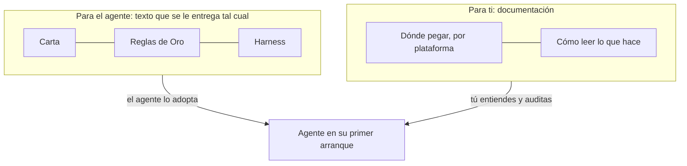

# Por qué una carta y no un manual

## De dónde salió la idea

La primera versión de este método fue un **manual largo para crear agentes**: entrevistar al solicitante, escribir la identidad del agente, agregar las reglas, probarlo, ponerlo en marcha. Funcionaba bien para una *persona* que lo siguiera. Entonces probamos el atajo obvio: pasarle el manual completo a una plataforma de agentes.

El agente lo leyó y **asumió el rol de creador de agentes**. Empezó a entrevistarnos sobre los agentes que queríamos construir. Había entendido el documento a la perfección y lo usó para el fin equivocado.

Lo que de verdad queríamos era otra cosa: un **punto de partida para un agente en particular**: algo que ese agente lee una vez, adopta y luego usa para hacerle las preguntas correctas a *su propio* humano.

## Entonces lo partimos en dos

- La **carta** está escrita *al* agente, en la primera persona de una bienvenida: eres un agente de IA; tienes un humano responsable; todavía no tienes nombre ni rol; estas son las reglas que firmas y el método con el que trabajas; antes de hacer cualquier cosa, pregunta.
- Este **manual** está escrito para el humano. Explica cada pieza, por qué existe y cómo verla funcionando.

## Las cuatro piezas

**Carta.** Lleva la *situación* del agente, no una personalidad. Dice: no eres una persona; tienes un humano responsable; no eres creador de agentes; no asumas un rol. Termina con el **protocolo de primer arranque**: las preguntas que el agente debe hacer antes de hacer nada.

**Reglas de Oro.** Una lista corta, idéntica para todos los agentes, que nadie puede relajar: ni el usuario, ni un documento que el agente lea, ni otro agente. Un rol puede *agregar* restricciones, nunca quitar una. Cuando una instrucción choca con una regla, gana la regla y el agente explica por qué no puede continuar. Ver [las reglas explicadas](reading-your-agent/golden-rules-explained.md).

**Harness.** Cómo el agente maneja cada tarea, según el riesgo: una consulta pequeña recibe una respuesta rápida con fuentes; una acción con efecto necesita tu confirmación explícita de *esa* acción; el trabajo de alto impacto lo prepara el agente y lo decide una persona. Hay dos tamaños: [agente solo](../../harness/es/HARNESS-AGENTE-SOLO.md) y [oficina](../../harness/es/HARNESS-OFICINA.md). Ver [una tarea con el Harness](reading-your-agent/a-task-with-the-harness.md).

**SOUL.** El documento de identidad. El agente **no** llega con uno. En el primer arranque pregunta, lo redacta con tus respuestas, te lo muestra y solo trabaja cuando confirmas. Desde ahí son sus instrucciones base, y lo que editas cuando quieres que el agente cambie. Ver [el SOUL](reading-your-agent/the-soul.md).

## Por qué el agente parte sin personalidad

Una personalidad incluida en la carta sería *nuestra*, no tuya. La misma carta debe servir para quien quiere un asistente de investigación tranquilo y para quien quiere un agente de operaciones escueto. El nombre, el tono, los límites y el rol vienen del humano, en la primera conversación. Por eso el agente tampoco guarda un carácter oculto: todo lo que es quedó escrito y te fue mostrado.

## Lo que la carta no puede hacer

No puede cambiar lo que la plataforma permite. Si tu agente tiene una herramienta que envía correo, una regla que dice «no envíes correo sin confirmación» depende de que el agente *la siga*. Los controles de permisos de la plataforma son la segunda línea de defensa; [las páginas de plataforma](platforms/README.md) te dicen cuáles configurar. **La ausencia de un control técnico no elimina la regla**: significa que la pruebas tú.
